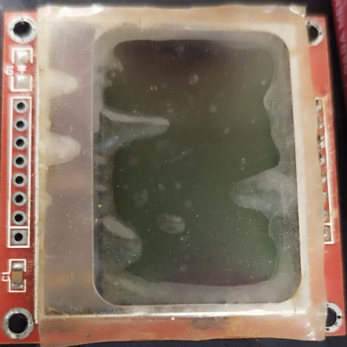
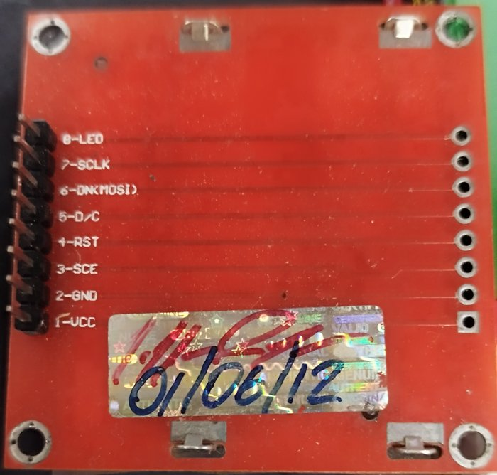
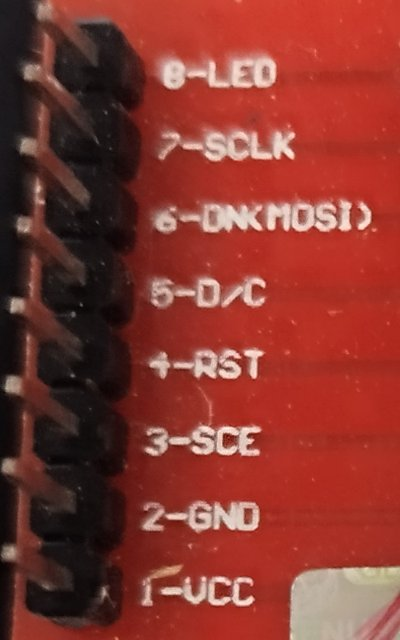

# S3 status display (Nokia 5110/3310 LCD), plan

**Status:** plan only, nothing built or coded. S3 bridge only; the A1S gets nothing.

**Goal:** a small live status screen on the S3 bridge. The bridge sits under the stack, so today its state is only visible in a browser. The screen shows the things most often checked, drawn as graphics (bars, graphs, icons, large digits) rather than lines of text, in several views chosen from the bridge's web page.

## The module

| Front | Back | Pin labels |
|---|---|---|
|  |  |  |

- **Controller:** PCD8544, 84 × 48 pixels, 1-bit, SPI (write-only).
- **Supply:** 3.3 V, so it connects straight to the S3. Logic draws under 0.5 mA without the backlight.
- **Board:** the red variant, with a right-angle header already fitted. A second, empty 8-hole row on the other edge carries the same signals.
- **Pins, as printed on the back:** 1 VCC, 2 GND, 3 SCE, 4 RST, 5 D/C, 6 DN (MOSI), 7 SCLK, 8 LED.
- **Condition:** the front is covered by a clouded film with residue. It looks like old protective film or tape rather than damaged glass, but it has to be checked first (step 1 below).

## Where it goes: beside the S3's free header

The S3's top header (J3) is unused on this board. From the antenna end it reads: GND, 43 (TX0), 44 (RX0), 1, 2, 42, 41, 40, 39, 38, 37, 36, 35, 0, 45, 48, 47, 21, 20, 19, GND, GND.

**The idea:** the module's header goes into the perfboard column right beside J3. Each module pin then sits next to an S3 pin, joined by a solder bridge, with no wire. The S3's GPIO matrix routes SPI to any pin, so only the ground pin has to land on a real GND.

**Fit:** the module's pin 2 (GND) goes beside J3's first GND. Pins 3–8 then fall on 43, 44, 1, 2, 42, 41. Pin 1 (VCC) sits one hole past the end of J3 and takes the only wire: a short one on the bottom face to the S3's 3V3, which is on J1 at the same (antenna) end.

| Module pin | Signal | S3 | Notes |
|---|---|---|---|
| 1 | VCC | 3V3 (J1), one short wire | the only wire |
| 2 | GND | J3 GND (antenna end) | solder bridge |
| 3 | SCE | GPIO43 (U0TXD) | the ROM prints its boot log here; harmless (chip-enable toggles while nothing else is driven) |
| 4 | RST | GPIO44 (U0RXD) | the firmware resets the display after boot |
| 5 | D/C | GPIO1 | |
| 6 | DN (MOSI) | GPIO2 | |
| 7 | SCLK | GPIO42 | |
| 8 | LED | GPIO41 | PWM (LEDC) dimming; see the backlight check |

**Why these pins are free:**
- **43/44:** the firmware's console is on USB-Serial/JTAG (`CONFIG_ESP_CONSOLE_USB_SERIAL_JTAG=y`), not UART0.
- **1/2:** reserved today for the frequency-module socket (`S3_FREQ_TX_PIN`/`S3_FREQ_RX_PIN`, UART0), which isn't built. That socket moves to **GPIO47/21**. GPIO21 is the A1S's PA-enable pin only; on the S3 it is free.
- **Avoided:** 35–37 (octal PSRAM), 0/45/46 (strapping), 48 (the RGB status LED), 19/20 (USB).

**In the drawing's coordinates** (`hardware/bridge-s3/layout/board-render.html`): J3 is column `Y(4)`, rows `X(9)`… The module header goes in column `Y(3)`, rows `X(8)` (VCC) to `X(15)` (LED). Both columns exist on the real 30 × 42 board, and that area is unwired today.

## Mounting

The right-angle header already on the module suits standing it **upright along the board edge**, like a front panel, beside the S3.
- The module is about 45 mm wide, centred on its 8 pins, so it overhangs the header by about 12 mm at each end along the edge.
- The other option is lying flat, overhanging the board edge. That needs a straight header instead.

**To decide:** whether that edge can be seen from outside the stack (the board sits at floor −1). If not, the screen needs a cut-out or a short ribbon to a visible spot, which brings wiring back.

**Antenna:** this is the S3's antenna end. The bridge uses the IPEX antenna, so the module's metal frame there matters little. Keep the frame clear of the IPEX lead.

## Checks before building

1. **The glass.** Peel the film and power the module from a bench supply: 3.3 V on VCC, GND, LED to 3.3 V. Look at the glass and the backlight.
2. **Backlight current and polarity.** On red boards LED is normally active high, through on-board resistors. Measure the current at 3.3 V:
   - up to about 20 mA: GPIO41 drives it directly;
   - more: add a small NPN or MOSFET and drive that instead.
3. **Contrast.** Find a working Vop (contrast) and bias on this unit with a test pattern. These vary between modules, and the settings will be exposed on the web page.

## What it shows

| View | Content |
|---|---|
| **Dashboard** | Large frequency digits and the mode, parsed from the CAT replies the bridge already relays. Icons for TX/RX, the radio link, Wi-Fi strength, client count, PA state. |
| **Spectrum** | Live 84-pixel-wide spectrum from the S3's own FFT, with a peak-hold line. Optionally a dithered 1-bit waterfall under it. |
| **Levels** | Bars with peak hold and clip marks: I/Q left/right (WM8782), RX audio and loop (PCM1808), DAC output (PCM5102A). |
| **System** | CPU sparklines for both cores, internal RAM and PSRAM bars, the chip temperature (internal sensor), uptime. |
| **Network** | Wi-Fi RSSI sparkline, KB/s per stream, WebSocket clients, IP address. |
| **TX** | Slot list, a playback progress bar, the TX channel. |
| **Overlays** (over any view) | PA emergency: full screen, inverted, backlight blinking. Wi-Fi setup (AP fallback): network name and IP. Firmware or page upload: progress bar. |

**Views are switched from the bridge's web page.** Auto-cycle with a set dwell time is an option.

## Firmware outline

- **Driver:** SPI2 at about 4 MHz.
  - The frame is 504 bytes and takes about 1 ms to send.
  - A low-priority task on core 0 redraws 3–5 times a second. The DSP stays alone on core 1.
- **Drawing:** u8g2 (it supports the PCD8544, and there's an ESP-IDF port) for fonts and primitives. Small widgets of our own for bars, sparklines, icons and digits. All views share one frame buffer.
- **Data:** everything shown already exists in the firmware:
  - `/status` and `/system-stats`;
  - the I/Q spectrum rows from `iq_dsp`;
  - the audio level meters;
  - the CAT traffic.
  - The only new piece is a small parser for `FA`/`IF` replies, to get the frequency and mode.
- **Settings in NVS:** view, auto-cycle and dwell time, contrast (Vop), bias, backlight level, invert.
- **HTTP:**
  - `GET/POST /display` for the settings.
  - `GET /display/frame` returns the current 504 bytes, so the web page can mirror the screen.
- **Capabilities:** a `display` feature in `/info` (S3 builds only), plus a `display` entry in `/capabilities`. The A1S doesn't announce it, so nothing shows there.

## Web page

A **Display** card under Hardware settings, on the S3 only:
- the view picker, auto-cycle and dwell time;
- contrast, backlight and invert;
- a live preview: the frame from `/display/frame` drawn on a canvas at 3–4× scale, so it shows exactly what the screen shows.

## Order of work

1. The checks above (glass, backlight current, contrast).
2. Hardware:
   - **Drawing and notes:** add the module and its solder bridges to the drawing, plus the VCC wire, and update `wiring.md`.
   - **Pin map:** move the frequency socket to GPIO47/21 in `bridge_config.h`.
3. Firmware: driver and a test pattern, then the dashboard view and the PA-emergency overlay.
4. HTTP settings and the frame endpoint; then the web card and preview.
5. The remaining views: spectrum, levels, system, network, TX.

## Open questions

- Can the board edge beside the S3 be seen from outside the stack? That decides between upright, flat, or a cut-out.
- Backlight current, and whether it needs a transistor.
- Whether the dithered waterfall is readable at 84 × 40 pixels, or the spectrum view keeps only the line.
